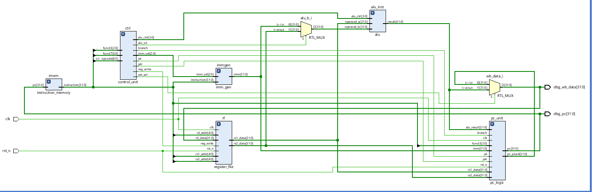
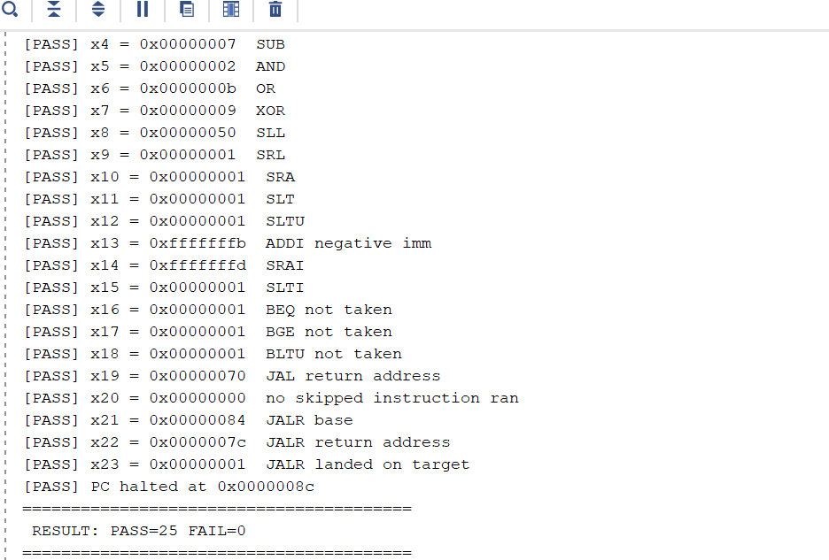
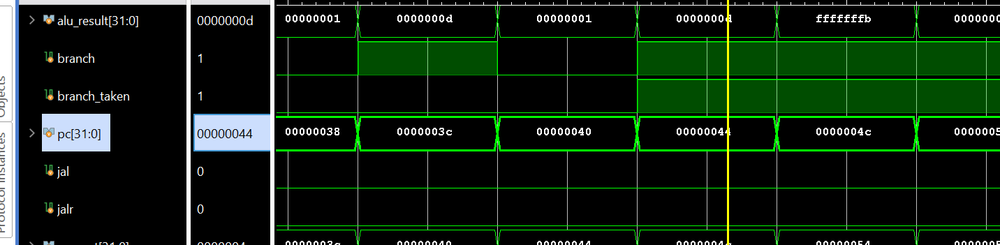
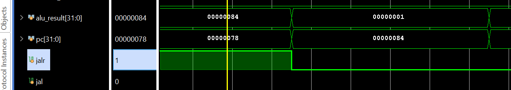

# Single-Cycle RISC-V Processor (RV32I Subset) in SystemVerilog

A 32-bit single-cycle RISC-V processor designed in SystemVerilog, verified
with a self-checking testbench, and synthesized in Xilinx Vivado 2022.1.
Every instruction is fetched, decoded, executed and written back in a
single clock cycle.



## Features

- 32-bit datapath with 32 general-purpose registers (x0 hardwired to zero)
- R-type and I-type ALU instructions
- All six conditional branches (signed and unsigned)
- JAL and JALR jumps with return-address write-back
- Immediate generator supporting I, S, B, U and J formats
- Two-level control unit (main decoder + ALU decoder)
- Self-checking testbench with an execution trace: **25/25 checks pass**

## Supported Instructions (27)

| Type   | Opcode    | Instructions                                         |
|--------|-----------|------------------------------------------------------|
| R-type | `0110011` | ADD, SUB, AND, OR, XOR, SLL, SRL, SRA, SLT, SLTU     |
| I-type | `0010011` | ADDI, ANDI, ORI, XORI, SLTI, SLTIU, SLLI, SRLI, SRAI |
| B-type | `1100011` | BEQ, BNE, BLT, BGE, BLTU, BGEU                       |
| J-type | `1101111` | JAL                                                  |
| I-type | `1100111` | JALR                                                 |

Not implemented: loads/stores (no data memory), LUI/AUIPC, CSRs and
exceptions. Unsupported opcodes execute as NOPs, so this is a **subset**
of RV32I rather than a complete implementation.

## Instruction Formats

```
Bit:     31        25 24    20 19    15 14  12 11       7 6       0
R-type: [  funct7    |  rs2   |  rs1   |funct3|    rd     | opcode  ]
I-type: [      imm[11:0]      |  rs1   |funct3|    rd     | opcode  ]
B-type: [imm[12|10:5]|  rs2   |  rs1   |funct3|imm[4:1|11]| opcode  ]
J-type: [      imm[20|10:1|11|19:12]          |    rd     | opcode  ]
```

## Architecture

```
PC --> Instruction ROM --> Decode --> Register File --> ALU --> Write-back mux
 ^                           |              |            ^           |
 |                       Control Unit    Imm Gen ----> ALU-B mux     |
 |                                                                   |
 +-- next-PC mux: PC+4 | PC+imm (branch/JAL) | (rs1+imm)&~1 (JALR) --+
```

Only the PC and the register file are clocked; all other logic is
combinational.

| File | Description |
|------|-------------|
| `riscv_pkg.sv` | Shared opcodes, ALU operation codes and enums |
| `alu.sv` | Combinational ALU with 10 operations |
| `imm_gen.sv` | Immediate extraction and sign extension |
| `control_unit.sv` | Main decoder (opcode) + ALU decoder (funct3/funct7) |
| `register_file.sv` | 32 x 32-bit, two combinational reads, one synchronous write |
| `pc_logic.sv` | PC register, branch comparator and next-PC selection |
| `instruction_memory.sv` | 64-word ROM containing the test program |
| `riscv_top.sv` | Top-level datapath |
| `tb_riscv_top.sv` | Self-checking testbench |

### Design Notes

- **x0** is forced to zero on reads and protected from writes.
- **SUB vs ADD** is decoded from funct7 only for R-type instructions; in
  ADDI those bits belong to the immediate.
- **Branches** use a dedicated comparator and a separate PC + imm adder,
  so the ALU is not involved in branch decisions.
- **JALR** target = (rs1 + imm) with bit 0 cleared, as the specification
  requires.
- The **register file** uses an asynchronous reset, so it maps to
  flip-flops.
- Debug ports `dbg_pc` and `dbg_wb_data` prevent synthesis from removing
  the design.

## Verification

The test program in `instruction_memory.sv`:

1. Loads operands using ADDI (x1 = 10, x2 = 3).
2. Executes all 10 R-type operations.
3. Tests a negative immediate (sign extension), SRAI and SLTI.
4. Tests all six branches, both taken and not taken. Register x20 is
   written only by instructions that should be skipped, so x20 = 0 proves
   that every taken branch skipped correctly.
5. Tests JAL and JALR, including their return addresses.
6. Attempts to write x0, which must remain 0.
7. Halts in a self-loop at address 0x8C.

### Results

```
 RESULT: PASS=25 FAIL=0
```



### Waveforms

**Branches:** BEQ at 0x3C is not taken, so the PC moves to 0x40. BNE at
0x44 is taken, so the PC jumps to 0x4C and skips 0x48.



**JALR:** at 0x78 the ALU computes the target address 0x84, and the PC
jumps there.



## How to Run

### Vivado GUI

1. Create an RTL project and add all `.sv` files except `tb_riscv_top.sv`
   as design sources.
2. Add `tb_riscv_top.sv` as a simulation source.
3. Run **Behavioral Simulation**. The Tcl console prints the execution
   trace and `RESULT: PASS=25 FAIL=0`.
4. Optionally run **Synthesis** to view the synthesized design.

### Command Line (Vivado Simulator)

```
xvlog -sv riscv_pkg.sv alu.sv imm_gen.sv control_unit.sv register_file.sv \
      pc_logic.sv instruction_memory.sv riscv_top.sv tb_riscv_top.sv
xelab tb_riscv_top -s riscv_sim -debug typical
xsim riscv_sim -runall
```

The testbench ends with `$stop`, which pauses the simulator in the GUI.
For command-line runs, change it to `$finish` so `xsim` exits.

## Future Work

- Data memory with load/store instructions (S-type immediate already generated)
- LUI and AUIPC (U-type immediate already generated)
- 5-stage pipeline with forwarding and hazard detection
- Running compiled C programs with a RISC-V GCC toolchain and `$readmemh`

## Author

**Kasthuri Padmanabha**, B.Tech Electronics & Communication Engineering,
PES University
